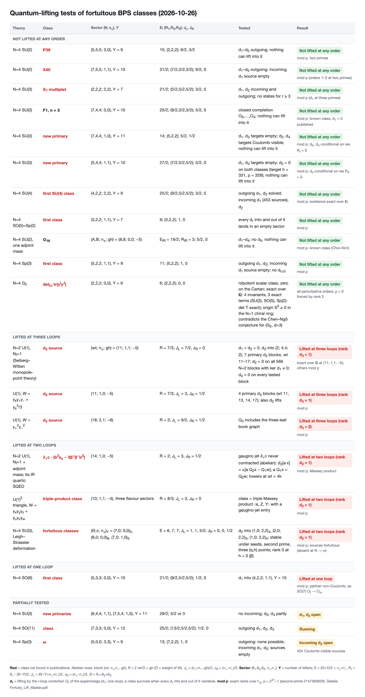

# Fortuitous Q-cohomology and quantum lifting: computational results

Botao Li, October 2026. Companion to [All-loop-holomorphic-kernels](https://github.com/lbotao399-stack/All-loop-holomorphic-kernels) (the operators Q_n used below).

**Running computations (updated daily): [STATUS.md](STATUS.md).**

**Master report (updated in place): [Fortuity_Lift_Master.pdf](Fortuity_Lift_Master.pdf).** Per theory: twisted action and components, Lie-algebra realization, highest-weight algorithm (which weights), frontier in conserved charges, fortuitous generators and classes, quantum-lift status, per-level data.

**Supplement (algorithm for the lifting tests): [supplement/Supplement_algorithm_for_the_lifting_tests.pdf](supplement/Supplement_algorithm_for_the_lifting_tests.pdf)**, with its LaTeX source. It is the supplementary material of the article "Holomorphic Feynman diagrams in four dimensions and the quantum BPS ring" (B. Li, K. Liu, C.-M. Chang): census algorithm, certification, and theory-by-theory tables and representatives (Sections S1–S8).

Red = class not found in publications.



## Theories

| theory | complete frontier (all sectors) | fortuitous generators and classes | quantum lift | PDF |
|---|---|---|---|---|
| N=4, SU(2) | E+J_L ≤ 33/2 | O_0 and its multiplet, O_1, products; $\color{red}{\text{P39}}$, $\color{red}{\text{X40}}$ | O_0, P39, X40: all orders; O_1: one loop | §1 |
| N=4, SU(3) | E+J_L ≤ 15 | $\color{red}{\text{X7 multiplet}}$, F1 and B1 towers; $\color{red}{\text{new primaries}}$ (5,4,4;1,1) Y10, (7,4,4;1,0) Y11, (6,4,4;1,1) Y11, (7,5,4;1,0) Y11 | X7, F1 (n=3): all orders; (7,4,4;1,0): all orders [cond]; (5,4,4;1,1): d_1 = d_2 = d_3 = 0, d_4 = 0 [cond] | §1 |
| N=4, SU(4) | E+J_L ≤ 14 | $\color{red}{\text{first SU(4) class}}$ (4,2,2;2,2) Y9, K=1 over Q; outside the BMN sector (n₊ = n₋ = 2, see Notes) | all orders | §1 |
| N=4, SU(5) … SU(15) | E+J_L ≤ 14, 15, 15, 31/2, 33/2, 17, 18 (N=5…10, 11–15) | none | – | §1 |
| N=4, SO(2N+1), Sp(N) | E+J_L ≤ 23/2 (SO(5), SO(7), SO(9)); ≤ 12 (Sp(3), Sp(4), Sp(5), SO(11)) | O_0 (SO(3)=Sp(1)); $\color{red}{\text{SO(5)=Sp(2)}}$ (3,2,2;1,1) Y7; O_f (SO(7)); $\color{red}{\text{Sp(3)}}$ (5,2,2;1,1) Y9 and $\color{red}{\omega}$; $\color{red}{\text{SO(9)}}$ (5,3,3;0,0) Y10; $\color{red}{\text{SO(11)}}$ (7,3,3;0,0) Y12 | SO(5), Sp(3) classes: all orders; O_f and the SO(9) class: one loop; SO(11): running. S-duality test: dim E_2^{SO(7)} = dim E_2^{Sp(3)} at every (E, R_I, J_L, J_R), E+J_L ≤ 11 (classical mismatch at 2, 2, 6, 7, 12 charges for E+J_L = 9 … 11, all removed by d_1 of SO(7)); SO(9) vs Sp(4) running | §2 |
| N=4, G2 | E+J_L ≤ 23/2 | $\color{red}{[\det_{IJ}\mathrm{tr}_7(\gamma^I\gamma^J)]}$ at (2,2,2;0,0) Y6 (E = 6, R = (2,2,2)): scalar chiral-ring class with ρ = 0, nilpotent (D² exact); exact over Q (4 invariants vs 3 exact terms; independent realization). Origin: N=1 chiral ring, S³ ≠ 0 for g2 (h∨ = 4) ⇒ det T ∉ commutator ideal; criterion rank < d < h∨; $\color{red}{\text{contradicts the Chen–Ngô conjecture for } (G_2, d=3)}$; same mechanism gives $\color{red}{\mathfrak{so}(7),\ d=4}$, contradicting Song–Xia–Xu Thm 1.2 | (2,2,2;0,0) Y6: all perturbative orders; d_1 = 0 everywhere, d_2 none, d_3 rank 0 | §7 |
| N=2 Z2 quiver, SU(N)×SU(N) | E+J_L ≤ 10 (N=2), ≤ 9 (N=3) | fortuity split open | d_2 = 0 on every candidate pair; E_r(κ) ≅ E_r(1) | §3 |
| N=2 SCQCD, SU(N), N_f=2N | E+J_L ≤ 12 (N=2), ≤ 9 (N=3) | fortuity split open | SU(2): d_1 = 0; d_2 = 0 on every candidate pair | §4 |
| N=4 SU(3), β and Leigh–Strassler deformations | E+J_L ≤ 21/2 (β), ≤ 11 (LS) | $\color{red}{\text{fortuitous}}$ (Θ,c;n+,n−)_Y = (7,0;0,0)_5, (7,0;1,0)_5 (LS) | $\color{red}{\text{LS: rank }d_2=1}$ at (7,0;0,0)_5, (8,0;0,0)_6, (7,0;1,0)_5, certified over Q; LS census: d_1 ≠ 0 in 53 pairs, d_2 ≠ 0 in 12 pairs; β: one d_2 at (5,2,2;1,0)_8 | §6 |
| massive-adjoint flows | w ≤ 16 (N=4 SU(2), one mass), w ≤ 12 (SU(3), one mass), w ≤ 13 (SCQCD SU(2) and Z2 quiver), w ≤ 11 (SCQCD SU(3)) | O_7, O_16 (Choi–Kim) | O_7, O_16: all orders; d_2 = d_3 = 0 on every candidate pair | §5 |
| abelian, U(1)^k with W (N=2 SQED N_f=1, 2 and N=1 deformations, U(1)^2 triangles) | wt ≤ 20 (N=2 SQED N_f=1), ≤ 24 (+ mass); about 84,000 blocks | classes from the never-contracted letters (U(1) gaugino jets, neutral chirals): products a·x and triple Massey products ⟨a,Z,Y⟩ | $\color{red}{\text{first d₃ ≠ 0}}$: N=2 SQED N_f=1 (Seiberg–Witten monopole-point theory), cubic singlet, quartic SQED; $\color{red}{\text{d₂ ≠ 0}}$ in N=1 deformations (Massey products); d_2 = 0 in N=2 SQED, but $\color{red}{\text{d₂ ≠ 0}}$ in the N=2 U(1)² linear quiver; $\color{red}{\text{first d₄ ≠ 0}}$: cubic singlet (`singlet_cubic_self`, $W = s x y + \tfrac13 s^3$) at $(16;1,1;-8)_0$ ($R=8/3, J_L=5, J_R=0$), exact over Q ([rational certificate](certificates/)) | §8 |
| N=2 SU(2), SU(3) SYM; SU(2) + adjoint + flip singlet (components, gauge-invariant subcomplex) | wt ≤ 12, J = n₊+n₋ ≤ 2 (SU(2) theories; wt 13, 14 running); wt 8–12, J ≤ 1 (SU(3), running) | products L·M: L = tr(bΦ) lifted at one loop, M with M·Q₁L exact (Massey-type); flip: flavour current J_f times M | $\color{red}{\text{first non-abelian d₂ ≠ 0}}$: N=2 SU(2) at (10;0,0;−5)₋₂ (exact over Q), (11;0,0;−6), (12;1,1;−5), (13;1,1;−6), (14;0,0;−7); N=2 SU(3) at (11;0,0;−5), (12;0,0;−6); flip at (9;1,1;−3)₀ (exact over Q), (11;0,0;−5), (12;0,0;−6); $\color{red}{\text{first non-abelian d₃ ≠ 0}}$: flip at (14;1,0;−6)₂, exact over Q (rational certificate: chain and dual functional verified on all 134,867 monomials of the stage blocks) | §9 |

## Notes

**The SU(4) class and BMN-sector scans.** The SU(4) class (4,2,2;2,2) Y9 has n₊ = n₋ = 2: four dotted letters (derivatives or gauginos). Its charges, E = 25/2, J_L = 3/2, J_R = 0, R_I = (9/2, 5/2, 5/2), equal those of the BMN block (6,4,4;0,0) Y11 = (λ + 2d, Y + 2); in the labels of [davidsd/fortuity-ai](https://github.com/davidsd/fortuity-ai) this is the column (6,4,4) at 2J = 3, level j = 2(E + J_L) = 28. Q_0 preserves λ, so H(Q_0) at these charges is the sum of the blocks with n₊ = n₋ = 0 (the BMN sector), 1 and 2, and the class lies in the block with n₊ = n₋ = 2. The fortuity-ai summary (§5) scans the SU(4) BMN sector completely through j = 30 and finds only multi-graviton classes; its README entry "no non-graviton class for j ≤ 30" refers to that sector, and it computes no SU(4) block with dotted letters. The two results are compatible. In the block both computations cover, (6,4,4;0,0) Y10 (column (6,4,4), 2J = 4), both find 46 classes, all multi-graviton.

**[Gram determinants on commuting schemes and the Chevalley restriction map](notes/Gram_determinants_commuting_schemes.pdf)** (October 2026, 13 pp.; [LaTeX source](notes/Gram_determinants_commuting_schemes.tex); [argument map](notes/Gram_determinants_argument_map.png)).
For simple g and d commuting copies, the SL_d-invariant degree-2d part of k[C^d_g]^G is one-dimensional exactly when d < h∨ (dual Coxeter number), spanned by the Gram determinant det B(x_i, x_j); the proof transfers the N=1 chiral-ring theorem S^{h∨−1} ≠ 0 (Cachazo–Douglas–Seiberg–Witten) to commuting tuples. For rk g < d < h∨ this class is nilpotent with zero Cartan restriction: a counterexample to the Chen–Ngô conjecture for G2 (d = 3), so_n (n ≥ 7) and all exceptional types, and to Song–Xia–Xu, Thm 1.2 (smallest case so(7), d = 4), whose Lemma 5.2 fails for every d ≥ 2. In the N=4 super-commuting setting the same component is one irreducible gl(3|2)-module containing the gaugino power S^d; for rk g < d < h∨ these S^d are the non-Coulomb monotone classes of Kibe–van Leuven–Mathieson ([arXiv:2610.22332](https://arxiv.org/abs/2610.22332), eq. (1)), who also relate S^4 of so(7) to the Chang–Lin class and construct its fortuitous one-loop partner. The note adds the purely even side: by Theorem A, S^d (two odd copies) and det T (d even copies) share one multiplicity space, which gives the commuting-scheme counterexamples above, the G2 class at (2,2,2;0,0) Y6, and the non-Cartan so(7) class behind the first SO(7)/Sp(3) mismatch.

## Conventions

```
λ = (θ1,θ2,θ3; n+,n−),   Θ = θ1+θ2+θ3,   Y = number of letters,   d = (1,1,1; −1,−1)

Q_n : C^Y(λ) → C^{Y+1−n}(λ − n d),        d_r : E_r^Y(λ) → E_r^{Y+1−r}(λ − r d)

E   = (Θ+Y)/2 + n+ + n−          R_I = θ_I − (Θ−Y)/2
J_L = (Θ − Y + n+ + n−)/2        J_R = (n+ − n−)/2
E   = R1 + R2 + R3 + 2 J_L       (λ + k d, Y + k) has the same (E, R_I, J_L, J_R)

massive flows, (A,B; n±; gh):  A = θ1+θ3,  B = θ2+θ3,  gh = Y − Θ
R1+R3 = A+gh,   R2+R3 = B+gh,   R_IR = (R1+R2)/2 + R3,   E_IR = (3/2) R_IR + 2 J_L
w = A + B + 2(n+ + n−) = (4/3)(E_IR + J_L)

abelian and SU(N) components, (wt; n+, n−; gh):  wt(γ_g) = w_g, wt(β^g) = D − w_g, wt(b) = D, wt(c) = 0   (D = weight of W)
R = 2 wt/D + gh,   J_L = (n+ + n− − gh)/2,   J_R = (n+ − n−)/2,   (R; J_L, J_R)(Q) = (1; −1/2, 0)
SU(N) components: gauge-invariant subcomplex (zero Cartan charge, kernel of the simple raising generators);
  subscript f = #γ_Φ − #β_Φ − 2(#γ_S − #β_S)
```

Certification: [Q] exact over Q; [Q, cert] rational chain (x_0, …, x_{r−1}) and dual functional φ verified exactly over Q on every monomial of the stage blocks; [p] ranks modulo p = 2^31 − 1; [p,p'] also p' = 2147483629; [cond] res(R_r) = 0 at targets with h = ρ.

## Data

| file | content |
|---|---|
| [data/N4_SU2_levels.csv](data/N4_SU2_levels.csv) | SU(2) per level: sectors, highest-weight classes, bosonic/fermionic states, non-graviton blocks |
| [data/N4_SU2_nongraviton_blocks.csv](data/N4_SU2_nongraviton_blocks.csv) | SU(2) odd-Y classes with charges and classification |
| [data/N4_SO_Sp_levels.csv](data/N4_SO_Sp_levels.csv) | SO(3…11), Sp(1…5) per level: sectors, h, f, fortuitous sectors |
| [data/N2_Z2_quiver_orbifold_point_levels.csv](data/N2_Z2_quiver_orbifold_point_levels.csv) | Z2 quiver per level: h, d_1, E_2, d_2 pairs and ranks |
| [data/N2_SCQCD_levels.csv](data/N2_SCQCD_levels.csv) | SCQCD per level |
| [data/massive_flows_levels.csv](data/massive_flows_levels.csv) | massive flows per w |
| [data/N4_G2_levels.txt](data/N4_G2_levels.txt) | G2 per level: sectors, fails, Σh, Σ(h−ρ), d_1 ≠ 0 blocks, Σ dim E_2, d_2/d_3 candidates and ranks |
| [data/abelian_census.csv](data/abelian_census.csv) | abelian theories: blocks, ker d_1 ≠ 0, d_3 and d_4 tests per theory |
| [data/abelian_primary_lifts.csv](data/abelian_primary_lifts.csv) | abelian primary lifts: block, flavour, (R, J_L, J_R), r, rank d_r, origin of d_2 |
| [data/su2_lifts.csv](data/su2_lifts.csv) | SU(2), SU(3) components: lifted blocks, (R, J_L, J_R), E_1, rank d_1, r, rank d_r, certification |
| [data/sdual_SO7_Sp3.txt](data/sdual_SO7_Sp3.txt), [data/sdual_SO9_Sp4.txt](data/sdual_SO9_Sp4.txt) | per level: Σh, number of charges with h or E_2 different, d_1 ≠ 0 blocks, d_2/d_3 candidates and ranks |
| [certificates/](certificates/) | standalone rational `[Q, cert]` lifting certificates and exact `PRIME=0` verifiers (including the four-loop $d_4 \ne 0$ certificate at `(16;1,1;−8)_0` in `singlet_cubic_self`, the three-loop $d_3 \ne 0$ certificate at `(13;1,1;−6)_0`, and the non-abelian $d_2 \ne 0$ certificate at `(10;0,0;−5)_{−2}` in $\mathcal N=2$ $SU(2)$) |
