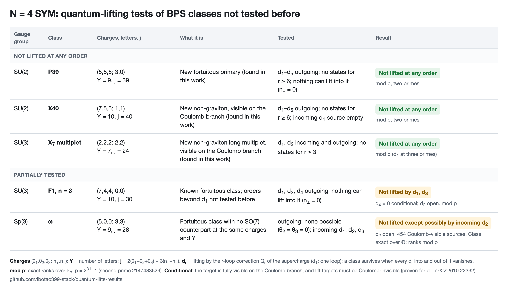

# Quantum lifting of BPS Q-cohomology classes in N=4 SYM: computational results

Botao Li, October 2026. Companion to [All-loop-holomorphic-kernels](https://github.com/lbotao399-stack/All-loop-holomorphic-kernels) (the operators $Q_n$ used below).

## Summary: classes tested for quantum lifting for the first time

| gauge group | class | charges, letters, $j$ | what it is | tested | result |
|---|---|---|---|---|---|
| SU(2) | **P39** | $(5,5,5;3,0)$, $Y=9$, $j=39$ | new fortuitous primary | $d_1$–$d_5$ outgoing; no states for $r\ge6$; no incoming ($n_-=0$) | **not lifted at any order** (mod p, two primes) |
| SU(2) | **X40** | $(7,5,5;1,1)$, $Y=10$, $j=40$ | new non-graviton, Coulomb-visible | $d_1$–$d_5$ outgoing; no states for $r\ge6$; incoming $d_1$ source empty | **not lifted at any order** (mod p, two primes) |
| SU(3) | **$X_7$ multiplet** | $(2,2,2;2,2)$, $Y=7$, $j=24$ | new non-graviton long multiplet, Coulomb-visible | $d_1,d_2$ incoming and outgoing; no states for $r\ge3$ | **not lifted at any order** (mod p; $d_1$ at three primes) |
| SU(3) | F1, $n=3$ | $(7,4,4;0,0)$, $Y=10$, $j=30$ | known fortuitous class; orders beyond $d_1$ not tested before | $d_1,d_3,d_4$ outgoing; no incoming ($n_\pm=0$) | not lifted by $d_1,d_3$; $d_4=0$ conditional; $d_2$ open (mod p) |
| Sp(3) | $\omega$ | $(5,0,0;3,3)$, $Y=9$, $j=28$ | fortuitous, no SO(7) counterpart at the same charges and $Y$ | no outgoing ($\theta_2=\theta_3=0$); incoming $d_1,d_2,d_3$ | not lifted except possibly by incoming $d_2$ (454 Coulomb-visible sources) |

$d_r$ = lifting by the $r$-loop correction $Q_r$ of the supercharge ($d_1$: one loop). Conditional: see §3.2.

## 0. Setup

$$Q(\hbar)=\sum_{n\ge0}\hbar^nQ_n,\qquad E_1=H(Q_0),\qquad d_r\ \leftrightarrow\ \text{lifting by the }r\text{-loop correction }Q_r$$

$$\lambda=(\theta_1,\theta_2,\theta_3;n_+,n_-),\qquad Y=\#\text{letters},\qquad j=2(\theta_1+\theta_2+\theta_3)+3(n_++n_-),\qquad d=(1,1,1;-1,-1)$$

$$Q_n:(\lambda,Y)\mapsto(\lambda-nd,\;Y+1-n),\qquad d_r:(\lambda,Y)\mapsto(\lambda-rd,\;Y+1-r),\qquad j(\lambda-rd)=j(\lambda)$$

$$\text{outgoing } d_r:\ r\le\min_i\theta_i,\qquad \text{incoming } d_r:\ r\le\min(n_+,n_-),\qquad \varepsilon=C(-1)^Y,\quad \varepsilon_t=(-1)^{r+1}\varepsilon_s$$

$h=\dim H(Q_0)$ on highest-weight cochains of a block; $\rho$ = rank of the Cartan (Coulomb) restriction on $H$; $g$ = graviton count; $h-\rho$ = Cartan-null classes.

$$O(\hbar)=\sum_{r\ge0}\hbar^rO_r,\qquad Q_0O_r=-R_r,\qquad R_r=\sum_{k=1}^{r}Q_kO_{r-k}$$

A class **survives all orders** when it has a closed completion $Q(\hbar)O(\hbar)=0$ and no incoming differential can reach it.

Certification levels: **[Q]** exact over $\mathbb Q$; **[p]** ranks modulo $p=2^{31}-1$; **[p,p']** two primes ($p'=2147483629$); **[cond]** conditional on the statement in §3.2.

## 1. Classes and their quantum fate

| gauge group | class | $(\lambda;Y)$, $j$ | classical | quantum fate | level |
|---|---|---|---|---|---|
| SU(2) | $O_0$ (threshold) | $(4,4,4;0,0)$; $Y7$, $j24$ | fortuitous | **survives all orders**: closed completion $\sum_{r\le4}\hbar^rO_r$ | [Q] |
| SU(2) | $O_1$ | $(6,6,6;0,0)$; $Y9$, $j36$ | fortuitous | **lifted at one loop**: $d_1\ne0$ (as in arXiv:2606.27955) | [p,p'] |
| SU(2) | P39 (new primary) | $(5,5,5;3,0)$; $Y9$, $j39$ | fortuitous; one fresh class beyond 12 known | **survives all orders**: closed completion $\sum_{r\le4}\hbar^rO_r$, $r=5$ target empty, no incoming | [p,p'] |
| SU(2) | X40 (new primary) | $(7,5,5;1,1)$; $Y10$, $j40$ | Coulomb-visible non-graviton, $(h,\rho,g)=(8,8,7)$ | **survives all orders**: closed completion $\sum_{r\le5}\hbar^rO_r$; incoming $d_1$ source empty | [p,p'] |
| SU(3) | $X_7$ (new multiplet) | $(2,2,2;2,2)$; $Y7$, $C=-1$, $j24$ | Coulomb-visible non-graviton, $(h,\rho,g)=(26,26,25)$; one long multiplet (35 HW blocks, $j24$–$30$) | **survives all orders**: $d_1=0$ in and out; $d_2$ target $(0,0,0;4,4)Y6$ empty; incoming $d_2$ source empty in $C=-1$; no pages $r\ge3$ | [p] ($d_1$: three primes) |
| SU(3) | $X_7$ pure-ghost member | $(0,0,0;5,5)$; $Y7$, $j30$ | exact rational representative (26 trace generators) | incoming $d_1=0$; no outgoing pages | class [Q]; $d_1$ [p] |
| SU(3) | F1 $n=3$ | $(7,4,4;0,0)$; $Y10$, $C=-1$, $j30$ | fortuitous (known) | $d_1=0$, $d_3=0$ (targets empty); $d_4=0$ [cond] (target $h=\rho=34$); **$d_2$ open** (target $h=609,\rho=608$) | [p] |
| SU(3) | new primary | $(7,4,4;1,0)$; $Y11$, $C=+1$, $j33$ | $h=2,\rho=0$ (one F1 $n=4$ descendant + one new class) | $d_3=0$ (target empty); $d_4=0$ [cond] (target $h=\rho=63$); $d_1,d_2$ open; no incoming | [p] |
| Sp(3) | $\omega$ | $(5,0,0;3,3)$; $Y9$, $j28$ | fortuitous; $h=1$, $\rho=0$; absent in SO(7) at this $(\lambda,Y)$ | no outgoing differential ($\theta_2=\theta_3=0$); incoming $d_1$, $d_3$ impossible (sources $h=0$); incoming $d_2$ only from 454 Coulomb-visible classes at $(7,2,2;1,1)Y10$ | class [Q]; sources [p] |
| SO(7) | $\beta$ | $(6,1,1;2,2)$; $Y10$ | Cartan-null, $h-\rho=1$ (Sp(3): 0) | only one-loop dynamics possible (incoming $d_2$ source empty, outgoing $r\le1$) | [p] |
| SO(7) | Konishi pair | $(3,3,3;0,0)Y8\to(2,2,2;1,1)Y8$, $j18$ | source $h=\rho=1$; target $h=2,\rho=1$ | **lifted at one loop**: $d_1$ rank 1 into the Cartan-null direction; Sp(3): source $h=0$ | [p] (three primes) |
| SO(7) | $j22$ pair | $(3,1,1;2,2)Y8\to(2,0,0;3,3)Y8$ | target $h=2,\rho=1$ | **lifted at one loop**: $d_1\ne0$ (rational separator); Sp(3): $d_1=0$ | [Q] |

### 1.1 Proven not lifted at any order

$$\text{SU(2): } O_0\ (j24),\quad \text{P39}\ (j39),\quad \text{X40}\ (j40);\qquad \text{SU(3): } X_7\ (j24).$$

### 1.2 Partial exclusions

$$\text{F1: } d_1=d_3=0,\ d_4=0\ [\text{cond}],\ d_2\ \text{open};\qquad j33:\ d_3=0,\ d_4=0\ [\text{cond}];\qquad \omega:\ \text{only incoming } d_2\ \text{remains}.$$

### 1.3 Lifted

$$\text{SU(2) } O_1\ (j36):\ d_1\ne0;\qquad\text{SO(7) Konishi pair }(j18),\ j22\text{ pair}:\ d_1\ne0.$$

## 2. Chain data for the all-order results

SU(2) P39, $(5,5,5;3,0)Y9$ [p,p']:

| $r$ | target $(\lambda-rd,\,Y+1-r)$ | target data | residual | verdict |
|---|---|---|---|---|
| 1 | $(4,4,4;4,1)$, 9 | $h=13$ | $Q_1O'$ | $d_1=0$ |
| 2 | $(3,3,3;5,2)$, 8 | $g_8=583$ | $R_2$, 45,450,714 terms | $R_2\in\mathrm{im}\,Q_0$ |
| 3 | $(2,2,2;6,3)$, 7 | $h=1$ | $R_3$, 17,787,235 terms | $R_3\in\mathrm{im}\,Q_0$ |
| 4 | $(1,1,1;7,4)$, 6 | $h=\rho=g=152$ | $R_4$, 1,276,152 terms | $R_4\in\mathrm{im}\,Q_0$ |
| 5 | $(0,0,0;8,5)$, 5 | $h=0$ | – | empty |

SU(2) X40, $(7,5,5;1,1)Y10$ [p,p']:

| $r$ | target | target data | residual | verdict |
|---|---|---|---|---|
| 1 | $(6,4,4;2,2)$, 10 | – | $Q_1O$, 4,429,603 terms | $d_1=0$ |
| 2 | $(5,3,3;3,3)$, 9 | – | $R_2$, 73,125,561 terms | $R_2\in\mathrm{im}\,Q_0+Q_1H$; corrected $O_1$ |
| 3 | $(4,2,2;4,4)$, 8 | $g_8=1112$ | $R_3$, 55,171,813 terms | $R_3\in\mathrm{im}\,Q_0$ |
| 4 | $(3,1,1;5,5)$, 7 | – | $R_4$, 8,915,576 terms | $R_4\in\mathrm{im}\,Q_0$ |
| 5 | $(2,0,0;6,6)$, 6 | $h=\rho=g=30$ | $R_5$, 187,328 terms, $\mathrm{res}\,R_5=0$ | $[R_5]=0$ |

SU(3) $X_7$, $(2,2,2;2,2)Y7$, $C=-1$ [p]:

| $r$ | direction | sector | data | verdict |
|---|---|---|---|---|
| 1 | out | $(1,1,1;3,3)$, 7 | $d_1$ rank 0 | 0 |
| 1 | in | $(3,3,3;1,1)$, 7 | $d_1$ rank 0 | 0 |
| 2 | out | $(0,0,0;4,4)$, 6 | $h=0$ | 0 |
| 2 | in | $(4,4,4;0,0)$, 8, $C=-1$ | $h=0$ | 0 |
| $\ge3$ | – | – | no cochains | 0 |

SU(3) F1 $n=3$, $(7,4,4;0,0)Y10$, $C=-1$ [p]:

| $r$ | target | $\dim$ | $h$ | $\rho$ |
|---|---|---|---|---|
| 1 | $(6,3,3;1,1)$, 10 | 34430 | 0 | 0 |
| 2 | $(5,2,2;2,2)$, 9 | – | 609 | 608 |
| 3 | $(4,1,1;3,3)$, 8 | 26400 | 0 | 0 |
| 4 | $(3,0,0;4,4)$, 7 | 1896 | 34 | 34 |

Sp(3) $\omega$ orbit (classes with equal physical charges) [p]:

| $(\lambda;Y)$ | SO(7) $h/\rho$ | Sp(3) $h/\rho$ |
|---|---|---|
| $(5,0,0;3,3);9$ | 0/0 | 1/0 |
| $(6,1,1;2,2);10$ | 355/354 | 354/354 |
| $(7,2,2;1,1);11$ | 1/0 | 1/0 |
| $(8,3,3;0,0);12$ | 41/40 | 41/40 |

$$\#\{\text{Cartan-null}\}_{SO(7)}=\#\{\text{Cartan-null}\}_{Sp(3)}=3:\ \omega\ (\text{Sp(3)},Y9)\ \text{and}\ \beta\ (\text{SO(7)},Y10)\ \text{carry the same physical charge}.$$

## 3. Structural results

### 3.1 Massey-type one-loop generators (SU(2), $Y=11$, $j41$–$45$)

$$7\ \text{blocks},\quad \dim E_2=1+1+2+2+4+2+5=17,\quad \text{every }E_2\text{ class}\in\mathrm{span}\,(E_2\cdot E_2)\ \ [p].$$

### 3.2 Cartan-null targets

$$\mathrm{res}\,(\hbar)Q(\hbar)=Q_{\rm IR}(\hbar)\mathrm{res}\,(\hbar),\qquad Q_{\rm IR}=0\ \Longrightarrow\ \mathrm{res}\,(R_r)=0\ \ \forall r\ \Longrightarrow\ h=\rho\text{ at the target}\Rightarrow d_r=0.$$

$r=1$: proven (arXiv:2610.22332). All $r$: $\mathrm{res}\,(\hbar)$ = integration over the massive root multiplets on the Coulomb branch; [cond] on $Q_{\rm IR}=0$ for Cartan composites. Data: $\mathrm{res}\,(R_r)=0$ identically in every computed residual ($R_5$ of X40: 187,328 terms; $R_2$ of the SU(2) $(8,7,7;0,0)$ block: 31,625,138 terms).

### 3.3 Index

$$\text{lifts remove }(B,F)\text{ pairs within a }Q\text{-stable block }(\theta_1-\theta_3,\theta_2-\theta_3,\theta_3+n_+,\theta_3+n_-)\ \text{fixed},\qquad \dim E_\infty\ge|\chi_{\rm block}|.$$

### 3.4 Coulomb-visible non-gravitons

$$\rho-g=1:\ \text{X40 (SU(2))},\ X_7\ (\text{SU(3)}),$$
contrary to a literal reading of "Coulomb-branch cohomology embeds into monotone cohomology" (arXiv:2510.24008 §2), and both survive every perturbative order, in tension with the perturbative form of the C-parity conjecture of arXiv:2610.20340.

## 4. A Lie-algebra cohomology class (exact)

$$0\ne[X_7]\in H^7\!\left(\mathfrak{sl}_3[z_+,z_-],\mathfrak{sl}_3;\mathbb C\right)_{(5,5)},\qquad X_7|_{\mathfrak h\otimes(z_+,z_-)}\ne0\qquad[\mathbb Q]$$

$$z=x_{H_6,(0,1)}\wedge x_{H_7,(0,1)}\wedge x_{H_6,(1,0)}\wedge x_{H_7,(1,0)}\wedge x_{H_7,(0,2)}\wedge x_{H_7,(1,1)}\wedge x_{H_7,(2,0)},\quad \partial z=0,\quad X_7(z)=4838400$$

$$\mathrm{im}\,(\text{relative Feigin map})\cap H^7_{(5,5)}=0\ \Longrightarrow\ \text{the relative Feigin map for }\mathfrak{sl}_3[z_+,z_-]\text{ is not surjective}\qquad[\mathbb Q]$$

## 5. Open

$$\text{F1: } d_2;\qquad j33:\ d_1,d_2;\qquad \omega:\ \text{incoming }d_2\ (\text{454 Coulomb-visible sources});\qquad \text{§3.2 at all orders}.$$
